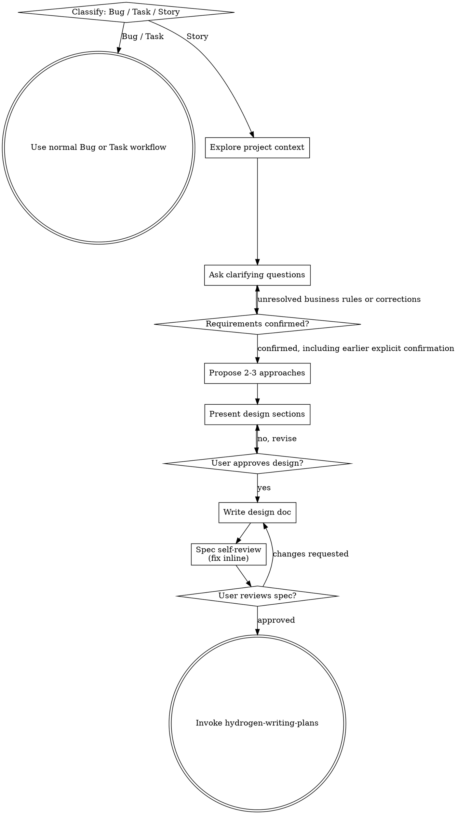

# Brainstorming Ideas Into Designs

> 版本: v2.2 (2026-11-13). 变更内容见文末版本记录.

Help turn Story-class changes into fully formed designs and confirmed specs through natural collaborative dialogue.

## 沟通与文档格式

> 适用于 Bug、Task、Story 全流程，hydrogen-brainstorming、hydrogen-writing-plans、hydrogen-coding 三个 skill 保持同一套规则。

### 1. 日常协作与写作依赖

1. 首行说明下一步动作.
2. 多步操作使用编号, 一项说明一个动作.
3. 阶段切换时简短说明当前进度.
4. 需要确认时集中列出真正待确认的事项, 沿用已有确认, 不重复询问.

撰写或修改文档时先读取 `hydrogen-writing` 的 SKILL.md, 已在当前上下文加载时直接复用. 用它优化结构, 表达和可读性, 保留事实, 限制与作者意图. 日常短回复不机械执行完整写作流程. 用户的明确要求优先; 本模块规定的阶段确认, 文档结构, 英文半角标点及准确性要求继续适用. 写作优化不改变业务结论, 不补造缺失事实, 不跳过已规定的审核阶段.

### 2. 文档格式

适用于 spec、实施计划、改造点清单、交付说明及本流程产出的其他 Markdown 文档。

1. **先做总结**：文档标题和元信息之后，第一节为 `## 1. 总结`，3～5 条编号要点，依次写目标、关键结论或决策、当前状态、下一步、待确认事项数量。读者只看总结就能知道做什么、做到哪、下一步是什么。
2. **标题编号**：除文档标题 `#` 外，所有标题带层级序号：`## 1.`、`### 1.1`、`#### 1.1.1`；序号连续，不跳号。
3. **正文编号**：步骤、规则、要点、待确认项使用有序列表 `1.`、`2.`；表格首列为序号列 `#`；只有不可再分的并列短语可用无序列表。
4. **清晰简洁**：一条只说一件事；不写铺垫和复述；同一事实只在一处定义，其他位置用“见 3.2”引用。
5. **完整一致**：术语、类名、字段名、接口路径、错误码全文一致；改动章节后同步更新所有“见 X.Y”引用、文档互链和索引；不留 TBD 或无归属的待办。

## 文档路径规则（所有项目）

- 所有项目的 spec 设计规格和实施文档统一存放在工作区根目录的 `设计文档/<需求名称>/`，同一需求共用一个目录，不再分别存入子仓库的 specs/plans 目录。
- 所有项目的架构文档统一存放在工作区根目录的 `架构文档/`，包括系统总览、服务边界、调用关系和整体数据流分析。
- 多仓库聚合工作区以聚合根目录为准；单仓库项目以项目根目录为准，不因进入子模块或使用 worktree 改变文档归属。
- 需求目录使用明确的业务名称，例如 `设计文档/最近执行结果查询/`；文件可保留日期和用途后缀，spec 使用 `YYYY-MM-DD-<topic>-design.md`，实施文档使用 `YYYY-MM-DD-<topic>-plan.md`。
- 延续同一需求时直接更新该目录中的现有文档. spec 只保留当前需求的最新有效内容, 澄清后直接替换旧结论, 删除已废弃或无关的内容, 不追加澄清历史, 旧新方案对照或取消事项回顾. 同步修正受影响的正文, 示例, 文档互链, 源码/SQL 链接及索引.
- 用户明确指定其他路径时优先按用户要求执行。此规则只规定文档位置，不要求为原本无需文档的任务新增 spec 或计划。

## 遵循 hydrogen-coding 规则

spec 中出现的类名、接口、分层、异常、注释、数据对象等，与将来写出的代码是同一份契约，必须从写 spec 阶段起就遵循 hydrogen-coding 的规则，而不是等到写代码时才对齐：

- 开始写 spec 前先读取 hydrogen-coding 的 SKILL.md（当前会话未加载时用 Skill 工具加载或直接读取文件），以其中的约定作为写 spec 的约束；两者冲突时以 hydrogen-coding 和用户的明确要求为准。
- 命名：新增的请求类以 `Req` 结尾、响应类以 `Resp` 结尾（含嵌套响应类型），不使用 `DTO`、`Payload`、`Data`、`Rsp` 等后缀；复用的存量类保留原名，不为统一后缀重命名。
- 复用与分层：优先复用或小幅扩展现有接口、Service、对象，新增类型须说明现有能力为何不满足；遵守项目现有分层约束（例如新增的 Mapper 只通过 `repository` 包的仓储接口及 `repository.impl` 实现访问，Service 或 Biz 依赖仓储接口；integration 根目录只放接口），按项目现状决定 Service 是否拆接口与实现。
- 异常：列出将使用的具体业务异常类型（复用或新增），新增业务异常须标为待用户确认。
- 其他：新建数据对象的 Lombok 约定、字符串判断用 StrUtil、充血模型归属、注释与日志语言等，在写 spec 中涉及时按 hydrogen-coding 写明，不写出与其冲突的设计。

## spec 只维护当前有效需求

1. 每轮澄清后将受影响的需求直接改成最新结论, 同步范围, 规则, 接口, 字段, 示例和验收标准. 不在文档尾部叠加修正说明, 不让读者靠拼接历次讨论判断最终要求.
2. 删除已被替代的方案, 已否决的选项, 与当前需求无关的内容及它们的专用待办和引用. 已取消事项不再保留单独章节, 对比表, 历史决策清单或未来采集任务; 若确实需要界定当前范围, 仅保留必要的简短范围说明.
3. 仍影响当前需求的未决问题保留为待确认, 不因精简而擅自假定已解决. 当前协议确实需要兼容的行为继续保留, 不把有效兼容要求误当作讨论历史删除.
4. 自检重点包括全文是否只有一套当前规则, 是否残留旧字段或旧接口, 示例和验收是否与最新结论一致, 删除章节后编号和引用是否有效. 除用户另有明确要求, 不为需求澄清新增版本对照或历史归档文档.

## Change Classification Gate

Code changes are classified before this skill is used:

- **Bug** restores existing expected behavior without adding a new business capability or contract. Do not use this Story workflow.
- **Task** is a bounded engineering or business change with a known solution and limited impact. Do not use this Story workflow.
- **Story** adds or materially changes an end-to-end business capability, or requires coordinated changes across modules, interfaces, persistence, messaging, or external dependencies. Use this complete workflow.

Announce the classification and a short reason. The human partner may override it. If a Bug or Task reveals Story-level scope, stop implementation, reclassify it, and begin this workflow. Never downgrade a Story during implementation merely to skip its gates.

## Establish Shared Understanding

The outcome of brainstorming is an understanding your human partner can
recognize and correct, grounded in what they want to accomplish.

1. **Discover intent.** Use the request and available context to identify
   the intended outcome, who it is for, and what success looks like. When
   that information is missing, ask one focused question about purpose or
   intended use before proposing features or an approach. Knowing the app
   genre does not tell you why your partner wants it. Gathering missing
   requirements does not ask them to authorize the task again.
2. **Write back your understanding.** Summarize the intended outcome,
   relevant constraints, and success criteria in a short numbered note your
   partner can assess. Separate what they said from assumptions. Invite
   correction and incorporate their answer before treating this as the
   design brief.
3. **Carry intent into the design.** Preserve the agreed understanding in
   the written Story spec. Check proposed features and technical choices
   against that understanding.

When the request already supplies the purpose and constraints, reflect
that understanding instead of asking the same questions again. Keep the
note concise; its accuracy and the opportunity to correct it matter.

<HARD-GATE>
For a Story, before taking any implementation action, including invoking
an implementation skill, writing product code, scaffolding, installing
product dependencies, or creating an external project, the human partner
must review and approve the written spec and then review and approve the
written implementation plan. Conversational design approval only permits
writing the spec; written-spec approval only permits invoking
hydrogen-writing-plans; plan approval permits task-by-task execution through
hydrogen-coding.

A reply approves the stage actually presented. Approval of an idea or
feature scope does not approve artifacts that do not exist yet. Resume
at the earliest incomplete stage; do not turn one approval into permission
to skip the rest of the selected path. Read-only project exploration is
allowed while those prerequisites remain incomplete.
</HARD-GATE>

## 需求逐项对齐

本节细化 Establish Shared Understanding 和 Story Workflow 的需求澄清阶段. 使用 hydrogen-brainstorming 时先建立可核对的业务理解, 再进入技术方案. 不因读到现有实现, 找到可复用接口或想到实现方案, 就认定需求已经明确.

### 1. 先列出需求理解与缺口

1. 阅读用户给出的需求文档, UI, 示例和当前会话中的决定, 再核对相关代码. 区分用户明确要求, 文档规定, 当前实现事实, 助手建议与尚未确认的假设. 当前代码只能说明现状, 不能替代用户期望.
2. 按实际相关性整理核对清单, 用简短编号或表格展示已明确的规则及关键缺口. 已有明确依据的内容直接引用来源, 不为完成清单重复询问; 不适用项可简要说明或省略, 不新增单独文件来维护清单.
3. 覆盖与本需求有关的目标和使用者, 页面或接口功能范围, 正常流程, 关键业务对象与字段语义, 异常与边界, 兼容影响以及可验证的验收结果. 先对齐业务行为, 再讨论 Controller, 表和消息拆分等实现细节.
4. 统计类需求额外核对统计单位, 范围与时间归属, 去重键, 首测与复测, 状态与质量结论, 分子分母以及零值或缺失值. 状态或消息类需求额外核对事件来源, 更新时机, 重复与乱序, 失败重试以及已有调用方兼容. 只展开实际相关的维度.

### 2. 围绕关键缺口逐轮追问

1. 一次只问一个有实际影响的问题. 先问会改变业务目标, 数据口径, 范围或验收结果的事项, 不把大张问题清单一次交给用户填写, 也不只问技术偏好.
2. 每个关键问题先说明当前理解或缺口, 再给一个具体场景说明不同选择会带来什么结果. 适合选择题时提供推荐项及理由, 但推荐不视为用户已同意. 例如同一对象多次执行时, 应分别计数还是只取最终结果, 用可复算样例核对.
3. 收到回答后更新相应规则和受影响的例子, 继续处理下一项关键缺口. 不用一次关于总体方向的回答替代所有细节结论, 不把未回复或沉默当作确认.
4. 用户已在本会话确认过的决定直接沿用. 新回答与先前决定或需求文档冲突时, 明确指出具体冲突及影响, 围绕这一差异澄清, 不重新盘问无关事项.
5. 没有固定提问轮数. 信息充分时直接核对理解, 不为了显得仔细而重复问答. 对不影响业务契约的实现细节可自行判断; 用户明确授权助手决定某项业务取舍时, 记录授权范围和选择理由.

### 3. 用规则和例子确认理解

1. 关键缺口处理后, 给用户一份简短的需求对齐结果: 目标与范围, 核心规则, 正常例子, 有影响的异常或边界例子, 剩余未决事项. 例子写出具体输入和预期输出, 让用户能发现口径偏差.
2. 对仍会改变业务行为, 外部契约, 持久化或验收结果的未决事项继续澄清, 不以助手推荐或自行选择一种解释来闭合. 已明确的部分可以继续只读分析; 不将未决规则写成已确认的 spec 结论.
3. 在关键规则已闭合且用户确认该需求理解后进入方案比较. 已有明确的需求理解确认则复用, 不额外索取同一次确认. 方案与 spec 保留规则及例子, 不只保留技术实现.
4. 用户明确要求先写草稿时可以先整理, 清楚标注未确认假设及影响; 草稿不等于已确认 spec, 未决事项仍需闭合后才能据此规划和实施. 用户只确认某个局部方案时, 确认范围限于该局部.

## Story Workflow

1. **Explore project context** — check files, docs, recent commits
2. **Align requirements** - follow the requirement-alignment section above: identify relevant rules and gaps, ask one focused question at a time, and verify concrete input/output examples.
3. **Propose 2-3 approaches** - after the business understanding is confirmed, compare trade-offs and give your recommendation without treating it as approval.
4. **Present design** — in sections scaled to their complexity, get user approval after each section
5. **Write design doc** — save to `设计文档/<需求名称>/YYYY-MM-DD-<topic>-design.md` under the workspace root, formatted per「沟通与文档格式」第 2 小节; do not commit it
6. **Spec self-review** — quick inline check for placeholders, contradictions, ambiguity, scope, format (see below)
7. **User reviews written spec** — ask user to review the spec file before proceeding
8. **Transition to implementation** — invoke hydrogen-writing-plans to create the implementation plan

## Process Flow

For a Story, the only next skill after hydrogen-brainstorming is
hydrogen-writing-plans.
Do not invoke an implementation skill until the user has reviewed and
approved the plan.

## The Process

The subsections below apply to the Story path.

**Understanding the idea:**

- Check out the current project state first (files, docs, recent commits)
- Before asking detailed questions, assess scope: if the request describes multiple independent subsystems (e.g., "build a platform with chat, file storage, billing, and analytics"), flag this immediately. Don't spend questions refining details of a project that needs to be decomposed first.
- If the project is too large for a single spec, help the user decompose into sub-projects: what are the independent pieces, how do they relate, what order should they be built? Then brainstorm the first sub-project through the normal design flow. Each sub-project gets its own spec → plan → implementation cycle.
- For appropriately-scoped projects, ask questions one at a time to refine the idea
- Prefer multiple choice questions when possible, but open-ended is fine too
- Only one question per message - if a topic needs more exploration, break it into multiple questions
- Focus on understanding: purpose, constraints, success criteria

**Exploring approaches:**

按 hydrogen-coding 的 "先审视整体链路, 再确定改动落点" 比较方案. 先核对相关入口, 分发, 消费及落库职责和真实依赖, 主动考虑上游编排与已有独立链路复用, 不把当前方法扩展作为默认前提. 用这些依据解释选定方案; 涉及异步调整时核对成功响应, 失败重试和一致性语义, 不为整体优化引入无关重构.

同时遵循 hydrogen-coding 的 "设计阶段兼顾性能与复杂度". 结合实际规模和关键路径成本比较方案, 将性能收益与一致性, 资源及维护代价一起考虑, 优先选择足够简单的方案. 不等到实施后才考虑明显瓶颈, 也不为假设中的未来规模引入额外机制.

- Propose 2-3 different approaches with trade-offs, numbered
- Present options conversationally with your recommendation and reasoning
- Lead with your recommended option and explain why
- YAGNI ruthlessly - remove unnecessary features from every approach and design

**Presenting the design:**

- Once you believe you understand what you're building, present the design
- Scale each section to its complexity: a few sentences if straightforward, up to 200-300 words if nuanced
- Number each section and restate progress (e.g. "第 2/5 节"); ask after each section whether it looks right so far
- Cover: architecture, components, data flow, error handling, testing
- Be ready to go back and clarify if something doesn't make sense

**Design for isolation and clarity:**

- Break the system into smaller units that each have one clear purpose, communicate through well-defined interfaces, and can be understood and tested independently
- For each unit, you should be able to answer: what does it do, how do you use it, and what does it depend on?
- Can someone understand what a unit does without reading its internals? Can you change the internals without breaking consumers? If not, the boundaries need work.
- Smaller, well-bounded units are also easier for you to work with - you reason better about code you can hold in context at once, and your edits are more reliable when files are focused. When a file grows large, that's often a signal that it's doing too much.

**Working in existing codebases:**

- Explore the current structure before proposing changes. Follow existing patterns.
- Where existing code has problems that affect the work (e.g., a file that's grown too large, unclear boundaries, tangled responsibilities), include targeted improvements as part of the design - the way a good developer improves code they're working in.
- Don't propose unrelated refactoring. Stay focused on what serves the current goal.

## After the Design (Story path)

**Documentation:**

- Write the validated design (spec) to `设计文档/<需求名称>/YYYY-MM-DD-<topic>-design.md` under the workspace root
  - (User preferences for spec location override this default)
- Format per「沟通与文档格式」第 2 小节: `## 1. 总结` first (goal, key decisions, status, next step, number of open questions), then numbered sections and numbered body text
- Use elements-of-style:writing-clearly-and-concisely skill if available
- Do not commit the design document. The human partner reviews and commits all artifacts and code.

**Spec Self-Review:**
Keep only the current requirements. Replace superseded conclusions and remove unrelated sections before reviewing consistency; do not append a discussion history or old/new comparison.

After writing the spec document, look at it with fresh eyes:

1. **Placeholder scan:** Any "TBD", "TODO", incomplete sections, or vague requirements? Fix them.
2. **Internal consistency:** Do any sections contradict each other? Does the architecture match the feature descriptions?
3. **Scope check:** Is this focused enough for a single implementation plan, or does it need decomposition?
4. **Ambiguity check:** Could a requirement change business behavior or acceptance results depending on interpretation? Return that gap to the user with a concrete example. Do not silently pick an interpretation. Preserve earlier confirmed decisions and any explicit delegation to choose.
5. **hydrogen-coding 规则检查：** spec 中新增的类名是否以 `Req` / `Resp` 结尾、存量类是否保留原名；是否优先复用现有能力、符合项目分层约束（新增 Mapper 经由 Repository 接口访问）；是否列出异常类型；有无与 hydrogen-coding 冲突的设计。发现即改。
6. **文档格式检查：** 首节为 `## 1. 总结`；所有标题与正文编号连续；“见 X.Y”引用有效；术语、类名、接口路径、错误码全文一致。发现即改。

Fix wording, formatting, and inconsistencies with confirmed rules inline. An unresolved business decision requires clarification and an updated understanding, not an invented rule. Recheck affected examples and spec sections before moving on.

**User Review Gate:**
After the spec review loop passes, ask the user to review the written spec before proceeding, next action first:

> "下一步：review `<path>` 的 `1. 总结`（约 5 分钟），再看正文。待确认：1. … 2. … 确认后我开始写实施计划。"

Wait for the user's response. If they request changes, make them and re-run the spec review loop. Only proceed once the user approves.

**Implementation:**

- Invoke hydrogen-writing-plans to create a detailed implementation plan.
- Do not invoke any other skill. hydrogen-writing-plans is the next step.

## 版本记录

- v2.2 (2026-11-13): 写作依赖替换为 hydrogen-writing, 内置四条日常协作规则, 保留原有确认流程与文档约定.

- v2.0 (2026-11-12): Hydrogen 三个模块统一升级版本号为 v2.0, 保留当前规则及历史版本记录.

- v1.7 (2026-11-12): 方案比较同时考虑实际性能成本和设计复杂度, 优先满足当前及有依据的预期规模, 避免盲目叠加优化机制.

- v1.6 (2026-11-12): 方案比较从完整相关链路和职责出发, 主动评估上游编排及独立处理能力复用, 核对异步失败语义, 避免默认在当前功能上叠加.

- v1.5 (2026-11-12): spec 直接维护最新有效需求, 删除被替代方案和无关内容, 不叠加澄清历史或旧新对照, 同步校正引用和验收.

- v1.4 (2026-11-12): 增加需求逐项对齐, 关键缺口逐轮追问和具体例子确认; 方案比较前核对业务理解, 修正自检中自行选择歧义解释的规则. 沿用已有确认, 不设固定问答轮数, 不把推荐或沉默当作确认.

- v1.3（2026-10-27）：新增「沟通与文档格式」：日常沟通遵循 `i-have-adhd`；spec 首节为 `## 1. 总结`，标题与正文均编号，清晰简洁、完整一致；Spec Self-Review 新增第 6 项；交付话术改为先给下一步。
- v1.2（2026-10-26）：分层约束改为与 hydrogen-coding v1.2 一致：新增 Mapper 只通过 repository 仓储接口及实现访问，Service 或 Biz 依赖仓储接口。
- v1.1（2026-10-26）：新增「遵循 hydrogen-coding 规则」一节，写 spec 阶段起即按 hydrogen-coding 约定命名（请求 `Req`、响应 `Resp`）、复用、分层、异常和注释，并在自检中核对。
- v1.0：初始版本（未标注版本号的历史内容）。